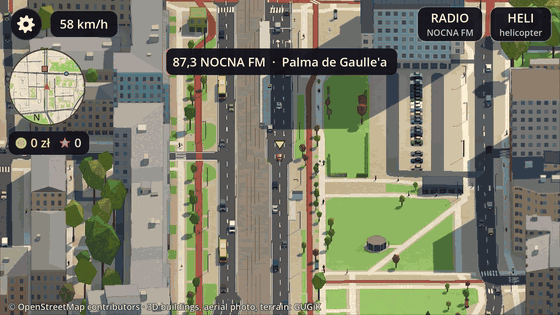

# Around Warsaw

**Drive, fly and discover the real Warsaw.** · *Jeźdź, lataj i odkrywaj prawdziwą Warszawę.*

Around Warsaw is a small-car arcade drive (and a helicopter) through the real centre of Warsaw,
built in Godot from OpenStreetMap and GUGiK open data. Gentle police, side jobs, a car radio
and Warsaw humour in Polish with English, on iPhone and Android, fully offline.

Website and beta sign-up: **[aroundwarsaw.app](https://aroundwarsaw.app)**.

## Features

- **The real city.** Streets, lanes, kerbs, bridges and tunnels from OpenStreetMap; GUGiK's 3D
  buildings, terrain and 12,500 laser-scanned trees; the landmarks built by hand (the Palace of
  Culture, Złote Tarasy, the Rotunda, Varso, the National Stadium). Tap one for its card.
- **A small car and a rescue helicopter.** Switch any time; the helicopter lands on flat roofs.
- **Side jobs.** Kebab delivery at 3 a.m., the Sunday *słoiki* run, Podwózka (the app taxi that
  trusts its GPS more than you), rescue calls and street races against the locals.
- **Gentle police.** Speed traps, a wave of the *lizak* and a talking-to; never a game over.
- **A living city.** Traffic that keeps to its lights, trams, pedestrians and pigeons in no hurry.
- **Day, dusk, night and rain**, or Live time with the real sun over Warsaw: neon, lamp light,
  wet streets and an optional VHS tape.
- **A car radio** (KEBAB FM, RONDO FM, MORDOR FM) and a city that talks back, Polish above
  English. Brands appear only as parodies.
- **Made for the phone.** 60 fps on an iPhone 11, three touch control schemes, no ads, no
  purchases, no network, no data collected.

## Status

An early demo. Today's map is about 3.5 × 1.8 km (6.3 km²), from Śródmieście to the National
Stadium. Coming on the road to the 1.0 demo ([docs/ROADMAP.md](docs/ROADMAP.md)):

- a 20 km² map (Rondo Daszyńskiego to the stadium, MDM to Barbakan) with the W-Z tunnel, Most
  Śląsko-Dąbrowski and Trasa Łazienkowska;
- about 40 more landmarks and proper facades;
- *Moja Warszawa*: shop fronts with parodies, metro entrances, the night and the river, the city
  guards;
- TestFlight and a Google Play closed test with Warsaw locals.

## Run it

1. Install [Godot 4.7.2](https://godotengine.org/download/).
2. `git clone https://github.com/LubomirOlshansky/AroundWarsaw.git`
3. `godot --path AroundWarsaw/game`, or open `game/project.godot` in the editor and press F5.
   The baked map is in the repo, so there is nothing to download or bake.

| | iPhone / Android | Mac / PC |
| --- | --- | --- |
| Drive | drag on the left half: the car heads where you point | W A S D / arrows |
| Brake, reverse | HAMULEC · brake | Space |
| Car ↔ helicopter | HELI / AUTO, top right | H (climb Space, sink Shift) |
| Radio | RADIO, top right | R |
| Zoom | pinch | mouse wheel |
| Time of day, rain, VHS | Settings (the gear) | N, O, V |
| Settings | the gear, top left | Esc |
| A landmark's card | tap it | click it |

Every flag, the other control schemes and how each part works:
[docs/DEVELOPMENT.md](docs/DEVELOPMENT.md).

## Build for the phone

- **iOS:** `tools/export_ios.sh`, then open the Xcode project in `build/ios/` and run it on your
  iPhone ([DEVELOPMENT.md, "Run it on your iPhone"](docs/DEVELOPMENT.md#run-it-on-your-iphone)).
- **Android:** `tools/export_android.sh --apk` for a debug APK
  ([DEVELOPMENT.md, "Android (Google Play)"](docs/DEVELOPMENT.md#android-google-play)).

## Data and credits

- Map data © [OpenStreetMap](https://www.openstreetmap.org/copyright) contributors, under the
  Open Database License (ODbL) 1.0.
- 3D buildings, terrain and aerial photographs: Główny Urząd Geodezji i Kartografii (GUGiK),
  [geoportal.gov.pl](https://www.geoportal.gov.pl), open data.
- 3D tree models: GUGiK, under CC BY 4.0.

Add-ons, music and the full list: [CREDITS.md](CREDITS.md).

## Licence

The code and the game's own art, music and sound are under the [MIT licence](LICENSE). The map
data in `game/map/` is not: it keeps its sources' licences (ODbL, GUGiK open data, CC BY 4.0),
as [CREDITS.md](CREDITS.md) says.

## Contributing

Issues and small pull requests are welcome: read [CONTRIBUTING.md](CONTRIBUTING.md) first (the
verification script, parodies only, Polish with English, the phone budget).

## Related Warsaw projects

Warsaw has good company: [Tiny Warsaw](https://tinywarsaw.app/) (a low-poly central Warsaw to
ride and fly through in the browser) and [Isometric Warsaw](https://bedirhanyildirim.com/warsaw-izo/)
(the whole city as an isometric pixel-art map, also from OSM and GUGiK). Around Warsaw took heart
from mrdoob's [Slop New York](https://github.com/mrdoob/slop-newyork) and the
[Slop Cities](https://github.com/zz85/slop-cities) list that grew around it.
